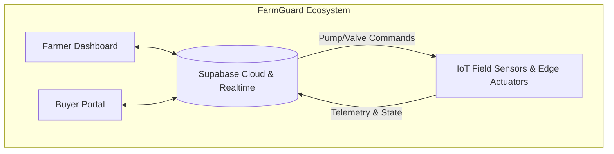
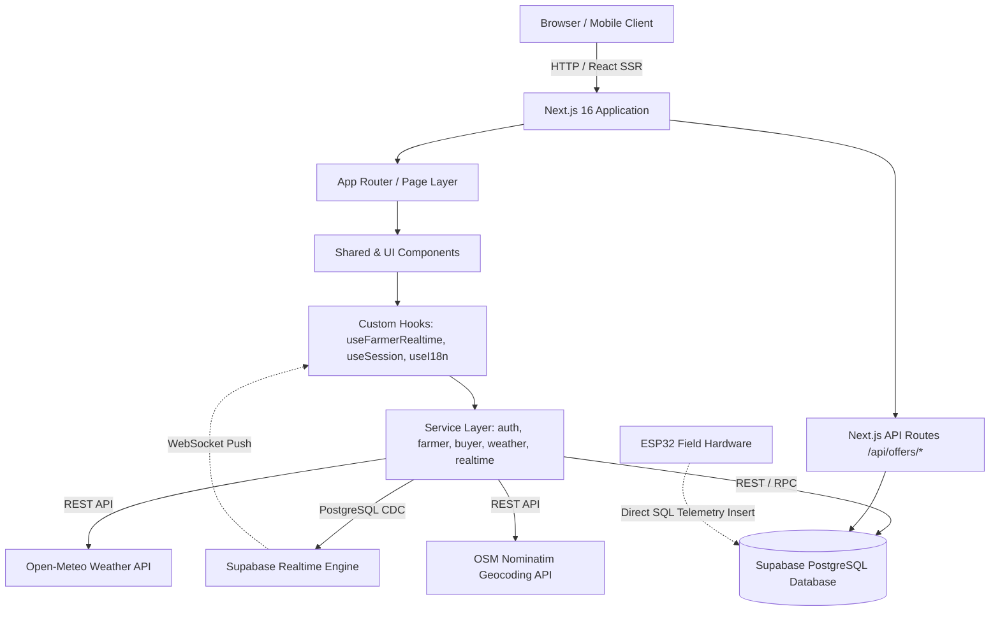
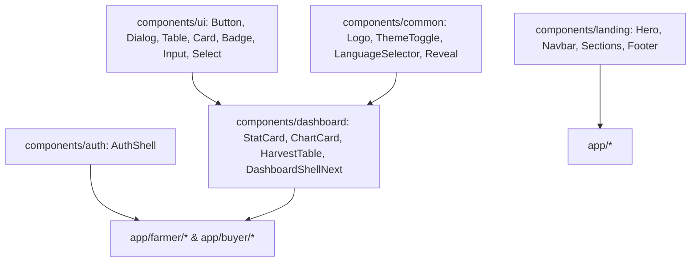
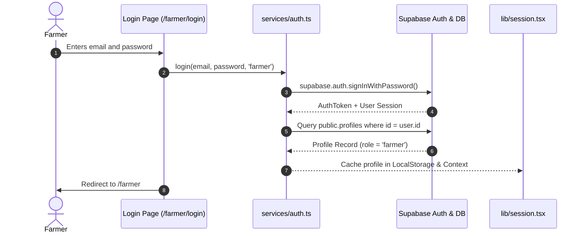
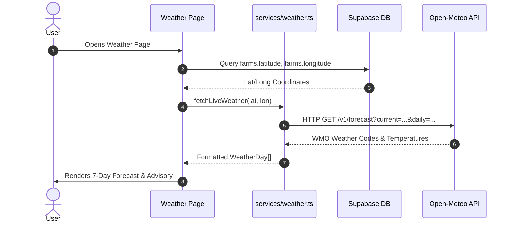
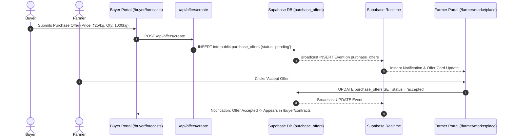
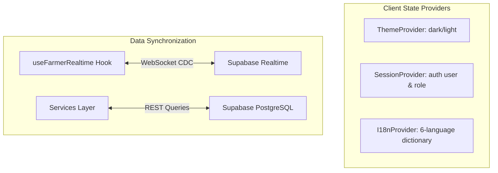
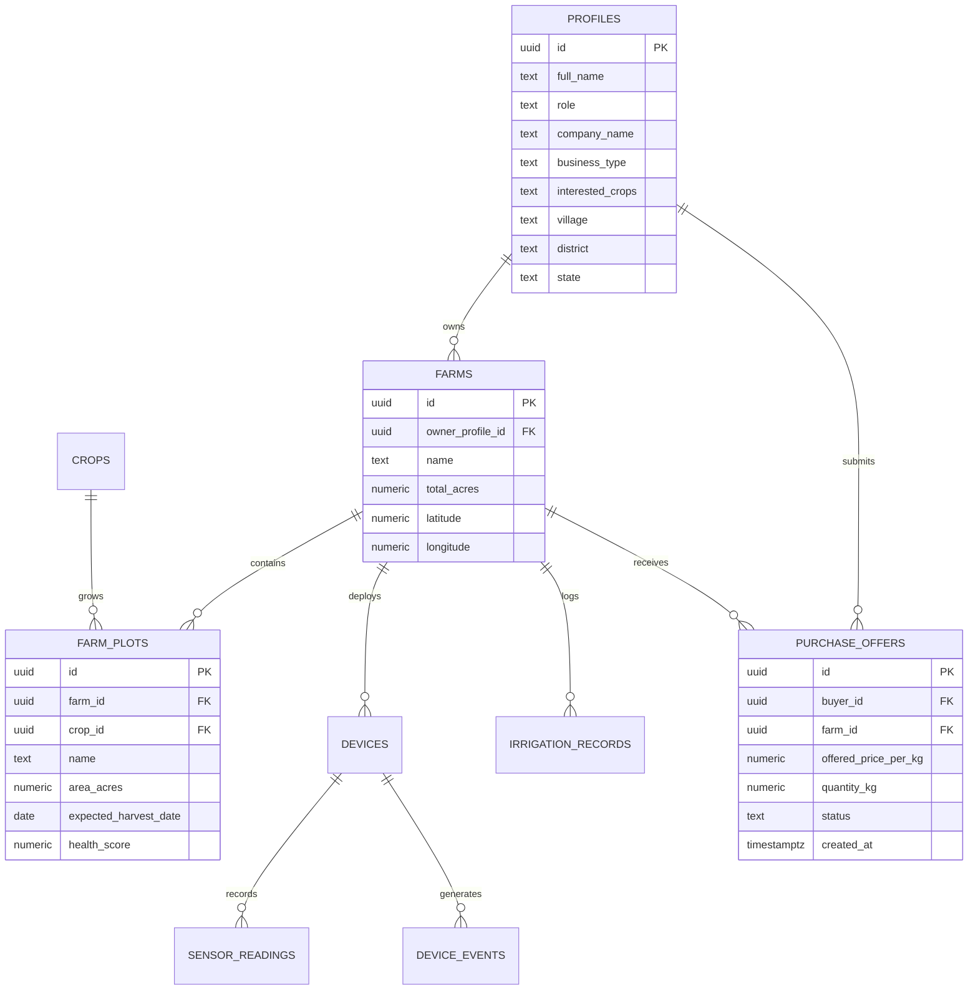
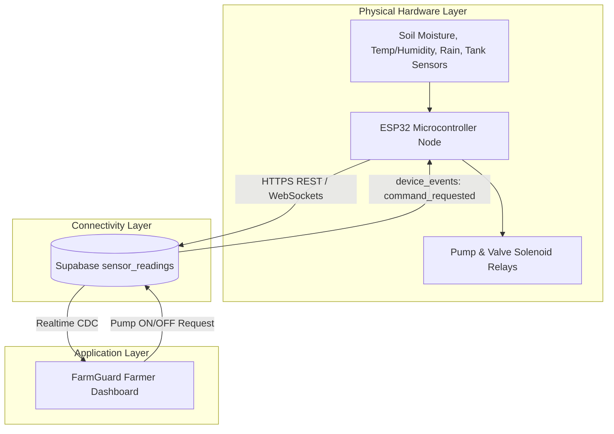
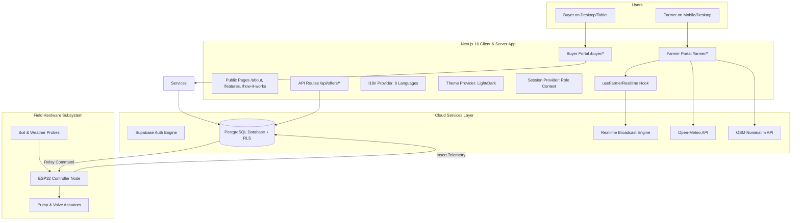

# FarmGuard — Smart Agriculture & Harvest Marketplace Platform

FarmGuard is an enterprise-grade smart agriculture platform connecting **farmers, agricultural buyers, and smart farm telemetry systems** into a unified web application. Built with Next.js 16 (App Router), React 19, TypeScript, Tailwind CSS 4, and Supabase, FarmGuard provides real-time farm sensor monitoring, automated irrigation actuation, crop health prediction, hyper-local Open-Meteo weather intelligence, and a bidirectional B2B crop procurement marketplace with 6-language localization.

---

## Table of Contents

1. [FarmGuard Overview](#1-farmguard-overview)
2. [Key Features](#2-key-features)
   * [Farmer Features](#farmer-features)
   * [Buyer Features](#buyer-features)
   * [Platform Features](#platform-features)
3. [System Architecture](#3-system-architecture)
4. [Detailed Project Architecture Map](#4-detailed-project-architecture-map)
5. [App Router / Route Map](#5-app-router--route-map)
6. [Component Architecture](#6-component-architecture)
7. [Data Flow Architecture](#7-data-flow-architecture)
8. [Authentication Architecture](#8-authentication-architecture)
9. [Supabase Architecture](#9-supabase-architecture)
10. [API Architecture](#10-api-architecture)
11. [Services Layer](#11-services-layer)
12. [Hooks](#12-hooks)
13. [State and Data Management](#13-state-and-data-management)
14. [Database Architecture](#14-database-architecture)
15. [External Services and Integrations](#15-external-services-and-integrations)
16. [Environment Variables](#16-environment-variables)
17. [Local Development Setup](#17-local-development-setup)
18. [Mobile / LAN Development](#18-mobile--lan-development)
19. [Production Deployment](#19-production-deployment)
20. [Security Architecture](#20-security-architecture)
21. [IoT / Smart Agriculture Architecture](#21-iot--smart-agriculture-architecture)
22. [Complete System Architecture Diagram](#22-complete-system-architecture-diagram)
23. [Technology Stack](#23-technology-stack)
24. [Development Guidelines](#24-development-guidelines)
25. [Project Status](#25-project-status)
26. [Future Improvements](#26-future-improvements)
27. [Contribution Workflow](#27-contribution-workflow)
28. [Final Architecture Summary](#28-final-architecture-summary)

---

## 1. FarmGuard Overview

### The Problem
Smallholder farmers and commercial agri-enterprises face fragmented challenges:
* **Water Inefficiency & Crop Loss**: Lack of real-time soil moisture and environmental telemetry leads to over/under-irrigation.
* **Disconnected Supply Chains**: Middlemen control crop pricing while institutional buyers struggle to predict harvest yields, quality scores, and regional production volumes.
* **Language & Digital Barriers**: Regional farming communities require native multilingual interfaces rather than complex English dashboards.

### The Solution
FarmGuard bridges the physical and digital agricultural ecosystem:
* **For Farmers**: Provides telemetry-driven crop health indicators, weather forecasts, pump/valve automation, irrigation history logs, and direct access to verified B2B buyers.
* **For Buyers**: Delivers farm discovery, harvest yield forecasts, quality audit scores, procurement request tracking, and digital contracts.
* **For the Smart Farm Ecosystem**: Bridges field micro-controllers (ESP32) and actuators with cloud databases via Supabase Realtime for instant command acknowledgment and alert streaming.



---

## 2. Key Features

### Farmer Features
* **Overview Dashboard (`/farmer`)**: Live connection state indicator, real-time sensor summaries, actual pump/valve status badges, live plot health indicators, 7-day weather cards, and dynamic analytics charts.
* **Smart Irrigation Control (`/farmer/irrigation`)**: Real-time pump ON/OFF and valve OPEN/CLOSE actuation routing through device events, live soil moisture/rain status advisory, and historical `irrigation_records` table (start time, plot, duration, water volume in Litres, and result).
* **Sensor Telemetry Hub (`/farmer/sensors`)**: Dedicated telemetry metric cards for Soil Moisture (%), Ambient Temperature (°C), Humidity (%), Rain Detection (%), Water Tank Level (%), and Gateway Battery (%) alongside hardware node diagnostics.
* **Crop Health Engine (`/farmer/crop-health`)**: Sensor-driven NDVI vegetation indices, thermal stress calculations, growth stage trackers, and harvest countdowns.
* **Weather Intelligence (`/farmer/weather`)**: Hyper-local Open-Meteo 7-day forecasts, precipitation probability, wind speed, relative humidity, and persistent GPS coordinate configuration.
* **Farm & Plot Management (`/farmer/my-farm`)**: Management of farm plots, crop types, acreage, soil types, and irrigation methods.
* **Analytics (`/farmer/analytics`)**: Historical calculations across selectable time ranges (`Today`, `7 Days`, `30 Days`, `All Time`) for average/min/max soil moisture, temperature, humidity, total water delivered (L), pump runtime (mins), and rain events.
* **Alerts & Warnings (`/farmer/alerts`)**: Live sensor threshold warnings (critical low moisture `< 20%`, excessive temperature `≥ 35°C`, rain detection) combined with database-logged device events.
* **Buyer Connections (`/farmer/marketplace`)**: Incoming B2B purchase offers with Accept/Reject actions, and a verified Buyer Directory where farmers can send direct harvest crop offers.
* **Settings (`/farmer/settings`)**: OpenStreetMap Nominatim GPS location geocoding, profile updates, theme switcher, and 6-language preferences.

### Buyer Features
* **Buyer Dashboard (`/buyer`)**: Aggregated expected harvest tonnes, high-quality farm counts, upcoming harvest pipeline, risk score metrics, dynamic crop availability charts, region production breakdowns, and supply/demand trends.
* **Available Farms & Forecasts (`/buyer/farms`, `/buyer/forecasts`)**: Filterable harvest table by crop, district, harvest month, and quality score with modal for submitting direct purchase offers.
* **Farm Detail View (`/buyer/farms/[farmId]`)**: Deep inspection of farm acreage, farmer identity, GPS coordinates, plot breakdown, soil types, sowing dates, and harvest dates.
* **Procurement Pipeline (`/buyer/procurement`)**: Live table of all submitted purchase offers, offered price per kg (₹), offered price per quintal (₹), quantity (tonnes/kg), and real-time status updates (`pending`, `accepted`, `rejected`, `completed`).
* **Contracts Management (`/buyer/contracts`)**: Active and completed contracts automatically generated from accepted purchase offers with total contract value (₹), agreed volume, and delivery timeframes.
* **Analytics & Reports (`/buyer/analytics`, `/buyer/reports`)**: Regional harvest distribution, supply committed vs forecast trends, and CSV export triggers for procurement performance and quality audits.
* **Buyer Settings (`/buyer/settings`)**: Company name, business type, interested crops, and procurement contact configuration.

### Platform Features
* **Strict Session & Role Isolation**: Dedicated `/farmer/*` and `/buyer/*` workspaces with scoped Supabase Row Level Security (RLS) ensuring privacy between users.
* **Real-Time Notification Engine**: Scoped Supabase Realtime listeners delivering in-app toast alerts, persistent notification dropdown items, and unread count badges.
* **6-Language Internationalization (i18n)**: 100% dictionary completeness across English (`en`), Hindi (`hi`), Tamil (`ta`), Kannada (`kn`), Malayalam (`ml`), and Telugu (`te`) with automated script validation (`validate_i18n.js`).
* **Dark / Light Theme Engine**: Built-in CSS custom property theming persisted in `localStorage`.
* **Mobile-Optimized LAN Development**: Configured `allowedDevOrigins` supporting cross-origin testing across local Wi-Fi IP addresses.

---

## 3. System Architecture



---

## 4. Detailed Project Architecture Map

```text
FarmGuard/
└── frontend/
    ├── app/                            # Next.js 16 App Router Directory
    │   ├── api/                        # Server-side API endpoints
    │   │   └── offers/                 # B2B Purchase offers endpoints
    │   │       ├── create/route.ts     # POST: Submit purchase/crop offer
    │   │       └── list/route.ts       # GET: List offers for buyer
    │   ├── buyer/                      # Buyer Workspace Pages
    │   │   ├── analytics/page.tsx      # Supply and demand analytics
    │   │   ├── contracts/page.tsx      # Active/completed contracts
    │   │   ├── farms/                  # Farm discovery pages
    │   │   │   ├── [farmId]/page.tsx   # Dynamic single farm inspection
    │   │   │   └── page.tsx            # Available farms list
    │   │   ├── forecasts/page.tsx      # Harvest yield forecasts
    │   │   ├── layout.tsx              # Buyer workspace navigation shell
    │   │   ├── login/page.tsx          # Buyer login page
    │   │   ├── page.tsx                # Buyer intelligence dashboard
    │   │   ├── procurement/page.tsx    # Purchase offers & procurement
    │   │   ├── reports/page.tsx        # Procurement reports & exports
    │   │   ├── settings/page.tsx       # Buyer profile & enterprise settings
    │   │   └── signup/page.tsx         # Buyer registration page
    │   ├── farmer/                     # Farmer Workspace Pages
    │   │   ├── alerts/page.tsx         # Threshold & device alerts
    │   │   ├── analytics/page.tsx      # Sensor & water usage analytics
    │   │   ├── crop-health/page.tsx    # Growth stages & NDVI indices
    │   │   ├── irrigation/page.tsx     # Smart pump/valve actuation panel
    │   │   ├── layout.tsx              # Farmer workspace navigation shell
    │   │   ├── login/page.tsx          # Farmer login page
    │   │   ├── marketplace/page.tsx    # Buyer offers & directory
    │   │   ├── my-farm/page.tsx        # Farm plot CRUD management
    │   │   ├── page.tsx                # Farmer dashboard overview
    │   │   ├── sensors/page.tsx        # Live telemetry hub
    │   │   ├── settings/page.tsx       # Farm GPS & profile settings
    │   │   ├── signup/page.tsx         # Farmer registration page
    │   │   └── weather/page.tsx        # 7-day Open-Meteo weather page
    │   ├── about/page.tsx              # Public marketing about page
    │   ├── contact/page.tsx            # Public contact page
    │   ├── features/page.tsx           # Public features overview
    │   ├── how-it-works/page.tsx       # Platform workflow explanation
    │   ├── login/page.tsx              # Unified login redirector
    │   ├── signup/                     # Role-based registration
    │   │   ├── buyer/page.tsx          # Dedicated buyer signup
    │   │   ├── farmer/page.tsx         # Dedicated farmer signup
    │   │   └── page.tsx                # Role selection portal
    │   ├── globals.css                 # Global CSS variables & Tailwind directives
    │   ├── layout.tsx                  # Root HTML shell & metadata
    │   ├── page.tsx                    # Landing homepage
    │   └── providers.tsx               # Theme, Session, and I18n providers
    ├── components/                     # Modular Reusable Component Hierarchy
    │   ├── auth/                       # Authentication wrapper cards & headers
    │   ├── common/                     # Logo, ThemeToggle, LanguageSelector, Reveal
    │   ├── dashboard/                  # Dashboard shell, widgets, harvest tables
    │   ├── landing/                    # Marketing navbar, hero, sections, footer
    │   └── ui/                         # 35+ Radix UI-based design system primitives
    ├── constants.ts                    # Global storage keys & configuration constants
    ├── data/                           # Fallback/seed baseline data structures
    │   ├── buyer.ts                    # Baseline buyer KPIs & mock constants
    │   └── farmer.ts                   # Baseline crops & initial parameters
    ├── hooks/                          # Custom React Hooks
    │   ├── use-farmer-realtime.ts      # Primary Supabase Realtime subscription hook
    │   └── use-mobile.tsx              # Responsive viewport detector hook
    ├── lib/                            # Core Library Utilities & Context Providers
    │   ├── i18n.tsx                    # 6-language dictionary & translation context
    │   ├── session.tsx                 # Supabase session & profile context
    │   ├── supabase.ts                 # Supabase client singleton
    │   ├── theme.tsx                   # Dark/Light theme provider
    │   └── utils.ts                    # Tailwind CSS class merger (clsx + twMerge)
    ├── public/                         # Static assets and branding logos
    ├── scripts/                        # Automation & validation scripts
    │   ├── update_i18n_fb.js           # Multi-language dictionary generator
    │   └── validate_i18n.js            # Automated 100% dictionary completeness test
    ├── services/                       # Business Logic & Backend Data Adapters
    │   ├── auth.ts                     # Supabase authentication & profile services
    │   ├── buyer.ts                    # Buyer KPIs, contracts, forecasts, & offers
    │   ├── farmer.ts                   # Farmer analytics, plots, offers, & actuation
    │   ├── geocoding.ts                # OpenStreetMap reverse geocoding
    │   ├── realtime.ts                 # Supabase Realtime subscriptions & command RPC
    │   └── weather.ts                  # Open-Meteo live forecast service
    ├── types/                          # TypeScript Domain Interfaces
    │   └── index.ts                    # Unified application type definitions
    ├── utils/                          # Formatting & conversion helpers
    │   └── format.ts                   # Date, currency (INR), number, & i18n formatters
    ├── next.config.ts                  # Next.js configuration & allowedDevOrigins
    ├── package.json                    # Dependencies & build scripts
    ├── supabase_buyer_setup.sql        # Supabase SQL schema, RLS policies, & tables
    └── tsconfig.json                   # TypeScript compiler options
```

---

## 5. App Router / Route Map

### Public Marketing & Authentication Routes
| Route | Type | Description |
|---|---|---|
| `/` | Static | Landing homepage with hero, telemetry highlights, and feature breakdown |
| `/about` | Static | Platform vision, team, and smart agriculture mission |
| `/features` | Static | Comprehensive breakdown of farmer and buyer capabilities |
| `/how-it-works` | Static | Visual step-by-step workflow of the FarmGuard ecosystem |
| `/contact` | Static | Support contact form and communication channels |
| `/login` | Static | Role selector leading to Farmer or Buyer login |
| `/signup` | Static | Role selection portal (`Farmer` vs `Buyer`) |
| `/signup/farmer` | Static | Dedicated farmer registration form |
| `/signup/buyer` | Static | Dedicated enterprise buyer registration form |

### Farmer Portal Routes (`/farmer/*`)
| Route | Type | Description |
|---|---|---|
| `/farmer` | Dynamic / Client | Farmer command center with live telemetry and actuator states |
| `/farmer/login` | Static | Farmer authentication portal |
| `/farmer/signup` | Static | Farmer account creation portal |
| `/farmer/sensors` | Dynamic / Client | Real-time sensor metrics and hardware node diagnostics |
| `/farmer/irrigation` | Dynamic / Client | Smart pump/valve actuation panel and irrigation history |
| `/farmer/crop-health` | Dynamic / Client | Growth stages, vegetation index, and harvest timers |
| `/farmer/weather` | Dynamic / Client | Open-Meteo 7-day forecast and GPS coordinate settings |
| `/farmer/my-farm` | Dynamic / Client | Farm plots management and crop configuration |
| `/farmer/analytics` | Dynamic / Client | Historical telemetry aggregates across custom time ranges |
| `/farmer/alerts` | Dynamic / Client | Real-time threshold warnings and hardware event logs |
| `/farmer/marketplace` | Dynamic / Client | Incoming buyer offers and direct crop offer proposals |
| `/farmer/settings` | Dynamic / Client | GPS geocoding, profile settings, and language selection |

### Buyer Portal Routes (`/buyer/*`)
| Route | Type | Description |
|---|---|---|
| `/buyer` | Dynamic / Client | Harvest intelligence overview, regional production, and supply KPIs |
| `/buyer/login` | Static | Buyer authentication portal |
| `/buyer/signup` | Static | Enterprise buyer registration portal |
| `/buyer/farms` | Dynamic / Client | Available farms directory and search |
| `/buyer/farms/[farmId]` | Dynamic / Server | Single farm inspection (where `[farmId]` is the Supabase UUID of the farm) |
| `/buyer/forecasts` | Dynamic / Client | Harvest forecast tables with offer submission modal |
| `/buyer/procurement` | Dynamic / Client | Real-time purchase offers pipeline and status tracking |
| `/buyer/contracts` | Dynamic / Client | Contracts derived from accepted purchase offers |
| `/buyer/reports` | Dynamic / Client | Exportable procurement analytics and quality audit summaries |
| `/buyer/analytics` | Dynamic / Client | Supply committed vs forecast and demand fulfillment charts |
| `/buyer/settings` | Dynamic / Client | Buyer organization and interested crops configuration |

---

## 6. Component Architecture

The component library is organized hierarchically:



### Component Structure
* **`components/ui/`**: 35+ accessible, unstyled primitives styled with Tailwind CSS (Dialog, DropdownMenu, Table, Select, Tooltip, Progress, Sheet, Sonner, Tabs, Toggle).
* **`components/dashboard/`**: Reusable dashboard chrome (`DashboardShellNext`), interactive widgets (`StatCard`, `ChartCard`), chart themes (`chart-theme.tsx`), and procurement tables (`HarvestTable`).
* **`components/common/`**: Theme toggler (`ThemeToggle`), multilingual dropdown (`LanguageSelector`), animated wrapper (`Reveal`), and logo (`Logo`).
* **`components/landing/`**: Marketing navigation (`SiteNavbar`), hero banner (`Hero`), feature sections (`Sections`), and footer (`SiteFooter`).
* **`components/auth/`**: Standardized authentication layout card (`AuthShell`).

---

## 7. Data Flow Architecture

### 1. Farmer Login Flow


### 2. Live Weather Flow


### 3. Bidirectional Procurement Flow


---

## 8. Authentication Architecture

```mermaid
graph LR
    User([User]) -->|Email/Password| SupabaseAuth[Supabase Auth (auth.users)]
    SupabaseAuth -->|Triggers Profile Lookup| ProfilesTable[public.profiles]
    ProfilesTable -->|role = 'farmer'| FarmerContext[Farmer Session]
    ProfilesTable -->|role = 'buyer'| BuyerContext[Buyer Session]
    FarmerContext --> ProtectedFarmerRoutes[/farmer/*]
    BuyerContext --> ProtectedBuyerRoutes[/buyer/*]
```

* **Storage**: Supabase JWT tokens are managed automatically by `@supabase/supabase-js`, while role and organization metadata are synced to `localStorage` under `farmguard_session` for zero-flicker reloads.
* **Role Verification**: `services/auth.ts` verifies that users signing into the farmer workspace hold `role: "farmer"` and buyers hold `role: "buyer"`.

---

## 9. Supabase Architecture

FarmGuard uses Supabase as its primary cloud backend:
* **Client Initialization (`lib/supabase.ts`)**: Initializes a singleton `createClient` using `NEXT_PUBLIC_SUPABASE_URL` and `NEXT_PUBLIC_SUPABASE_ANON_KEY`.
* **Realtime Subscriptions (`services/realtime.ts`)**: Subscribes to PostgreSQL Change Data Capture (CDC) events across `sensor_readings`, `devices`, `device_events`, `irrigation_records`, and `purchase_offers`.
* **Row Level Security (RLS)**: Enforces strict data ownership boundaries so that farmers can only access records matching `farms.owner_profile_id = auth.uid()`.

---

## 10. API Architecture

Next.js Route Handlers handle secure server-side mutations:

| Method | Endpoint | Purpose | Input Payload | Output Response | Authentication |
|---|---|---|---|---|---|
| `POST` | `/api/offers/create` | Creates a B2B purchase offer or farmer crop proposal | `{ farm_id: string, offered_price_per_kg: number, quantity_kg: number, buyer_id?: string }` | `{ success: boolean, data: PurchaseOffer }` | Bearer Token / Supabase Auth |
| `GET` | `/api/offers/list` | Fetches purchase offers for the authenticated buyer | Query: `?buyer_id=UUID` | `{ success: boolean, data: PurchaseOffer[] }` | Bearer Token / Supabase Auth |

---

## 11. Services Layer

| Service File | Responsibility | External Dependencies | Consumed By |
|---|---|---|---|
| `services/auth.ts` | Login, signup, password resets, session caching, and profile management | Supabase Auth, `public.profiles` | Login/Signup pages, `lib/session.tsx` |
| `services/farmer.ts` | Analytics calculations, plot CRUD, buyer offers, interested buyers query, and actuator commands | Supabase DB, `/api/offers/create` | `/farmer/*` pages |
| `services/buyer.ts` | Dynamic KPI calculations, harvest forecasts, contracts derivation, and chart aggregations | Supabase DB, `/api/offers/*` | `/buyer/*` pages, `HarvestTable` |
| `services/realtime.ts` | Realtime channel subscriptions, actuator command RPCs, and scoped notifications | Supabase Realtime | `useFarmerRealtime`, `DashboardShellNext` |
| `services/weather.ts` | Open-Meteo API queries, WMO code translations, and 7-day forecasts | Open-Meteo API | `/farmer/weather`, `/farmer/page.tsx` |
| `services/geocoding.ts` | Reverse geocoding of GPS coordinates to village/district/state names | OpenStreetMap Nominatim | `/farmer/settings`, `/farmer/my-farm` |

---

## 12. Hooks

* **`useFarmerRealtime()` (`hooks/use-farmer-realtime.ts`)**:
  - *Purpose*: Core hook powering the farmer dashboard. Fetches initial snapshot (`loadFarmerBootData`) and subscribes to live updates via Supabase Realtime (`subscribeFarmerDashboard`).
  - *Outputs*: `sensorReadings`, `pumpActual`, `requestedPump`, `valveActual`, `commandStatus`, `irrigationStatus`, `farmPlots`, `weeklyMoisture`, `waterUsage`, `cropHealthTrend`, `alerts`, `devices`, and actuator command dispatchers (`requestPumpCommand`, `requestValveCommand`).
* **`useMobile()` (`hooks/use-mobile.tsx`)**:
  - *Purpose*: Detects mobile viewports (`window.matchMedia("(max-width: 768px)")`) for responsive navigation drawers and dialog positioning.

---

## 13. State and Data Management



---

## 14. Database Architecture

The application schema is defined in `supabase_buyer_setup.sql` and related migrations:



---

## 15. External Services and Integrations

| External Service | Endpoint / Integration | Purpose | Data Persistence |
|---|---|---|---|
| **Supabase Cloud** | `https://<project-ref>.supabase.co` | Database, Authentication, and Realtime Engine | Stored persistently in PostgreSQL |
| **Open-Meteo** | `https://api.open-meteo.com/v1/forecast` | Hyper-local 7-day temperature, humidity, rain, and wind forecasts | Queried on demand based on farm GPS coordinates |
| **OSM Nominatim** | `https://nominatim.openstreetmap.org/reverse` | Converts GPS lat/lon to village, district, and state names | Stored in `farms` and `profiles` tables |

---

## 16. Environment Variables

Create a `.env` file in the `frontend/` directory:

```env
# Base URL of the FarmGuard API (used by services/*)
NEXT_PUBLIC_API_BASE_URL=https://api.farmguard.in

# Weather provider endpoint used by services/weather.ts
NEXT_PUBLIC_WEATHER_API_URL=https://api.open-meteo.com/v1/forecast

# MQTT / websocket endpoint for live sensor streaming (optional)
NEXT_PUBLIC_SENSOR_STREAM_URL=

# Supabase project configuration
NEXT_PUBLIC_SUPABASE_URL=https://your-project.supabase.co
NEXT_PUBLIC_SUPABASE_ANON_KEY=your-supabase-anon-key
```

> [!NOTE]
> `NEXT_PUBLIC_SUPABASE_URL` and `NEXT_PUBLIC_SUPABASE_ANON_KEY` are safe for browser execution as database access is constrained by Supabase Row Level Security (RLS) policies.

---

## 17. Local Development Setup

### Prerequisites
* **Node.js**: v18.18.0 or higher (v20+ recommended)
* **npm**: v9 or higher

### Installation
```bash
# 1. Clone the repository
git clone https://github.com/abulaasvh/FARMGUARD.git
cd FARMGUARD/frontend

# 2. Install dependencies
npm install

# 3. Configure environment variables
cp .env.example .env
# Edit .env with your Supabase project credentials

# 4. Start local development server
npm run dev
```

Open [http://localhost:3000](http://localhost:3000) in your browser.

---

## 18. Mobile / LAN Development

To test the application on a mobile device or tablet connected to the same local Wi-Fi network:

1. Determine your computer's local IP address (e.g., `192.168.x.x`).
2. Verify that your IP is included in `allowedDevOrigins` in `next.config.ts`.
3. Launch the development server bound to all network interfaces:
   ```bash
   npm run dev -- --hostname 0.0.0.0
   ```
4. On your mobile browser, navigate to:
   ```text
   http://YOUR_LOCAL_IP:3000
   ```

---

## 19. Production Deployment

### Building Locally
```bash
npm run build
npm run start
```

### Deploying to Vercel
1. Push your repository to GitHub.
2. Import the project into [Vercel](https://vercel.com).
3. Set the **Root Directory** to `frontend`.
4. Add your production environment variables (`NEXT_PUBLIC_SUPABASE_URL`, `NEXT_PUBLIC_SUPABASE_ANON_KEY`).
5. Deploy.

---

## 20. Security Architecture

* **Row Level Security (RLS)**: Enforced directly on Supabase PostgreSQL tables (`purchase_offers`, `farms`, `farm_plots`, `devices`, `sensor_readings`). Farmers can only query or update records associated with their profile.
* **Role-Based Routing**: Farmer and buyer layout shells verify authenticated user roles upon mounting and redirect unauthorized roles.
* **Input Validation & Sanitization**: API route handlers validate numeric bounds for quantities and prices before executing database transactions.

---

## 21. IoT / Smart Agriculture Architecture



* **Implemented**: Database schema for sensor telemetry (`sensor_readings`), device metadata (`devices`), actuator commands (`device_events`), and historical irrigation logs (`irrigation_records`).
* **Hardware Interfacing**: Microcontrollers insert rows directly into `sensor_readings` and poll/listen to `device_events` for queued actuation commands.

---

## 22. Complete System Architecture Diagram



---

## 23. Technology Stack

* **Core Framework**: [Next.js 16.3.0](https://nextjs.org/) (App Router, Turbopack)
* **Frontend Library**: [React 19.2.0](https://react.dev/)
* **Type System**: [TypeScript 5.x](https://www.typescriptlang.org/)
* **Styling**: [Tailwind CSS 4.x](https://tailwindcss.com/) with CSS variables
* **Cloud Database & Auth**: [Supabase](https://supabase.com/) (`@supabase/supabase-js` v2.84.0)
* **Data Visualization**: [Recharts](https://recharts.org/) (v2.15.4)
* **UI Components**: [Radix UI Primitives](https://www.radix-ui.com/)
* **Animations**: [Motion](https://motion.dev/) (v13.0.0)
* **Icons**: [Lucide React](https://lucide.dev/) (v0.575.0)
* **Toasts**: [Sonner](https://sonner.emilkowal.ski/) (v2.0.7)

---

## 24. Development Guidelines

1. **Do not commit `.env` or secrets**: Always use `.env.example` as a template.
2. **Type Safety**: Run `npx tsc --noEmit` before opening pull requests.
3. **Dictionary Completeness**: Whenever adding new UI keys, add translations across all 6 languages and validate with `node scripts/validate_i18n.js`.
4. **Service Separation**: Keep business logic in `services/` and database interactions decoupled from presentation components.
5. **Clean Data Boundaries**: Never introduce mock data fallbacks for authenticated user views.

---

## 25. Project Status

| Area | Implementation Status | Notes |
|---|---|---|
| **Frontend Architecture** | Complete | Next.js 16 App Router, responsive design, light/dark themes |
| **Farmer Dashboard** | Complete | Real telemetry display, actuation controls, analytics, crop health |
| **Buyer Portal** | Complete | Farm discovery, harvest yield forecasts, procurement, contracts |
| **Authentication & RBAC** | Complete | Scoped Farmer and Buyer authentication with Supabase Auth |
| **Realtime Notifications** | Complete | Scoped bidirectional notification engine for offers and alerts |
| **Multilingual (i18n)** | Complete | 100% dictionary completeness across EN, HI, TA, KN, ML, TE |
| **Weather Integration** | Complete | Open-Meteo 7-day live forecasts by farm GPS coordinates |
| **IoT / Cloud Telemetry** | Complete | Cloud schema, realtime channels, and actuation request pipeline |
| **Production Build** | Complete | 0 TypeScript errors, all 36 routes compiling cleanly |

---

## 26. Future Improvements

* **Edge Gateway Firmware**: Standardized C++ / MicroPython firmware sketches for automatic Wi-Fi / LoRa provisioning.
* **AI Yield Prediction Models**: Integration of satellite NDVI imagery overlays with historical weather trends for crop yield forecasting.
* **Payment Gateway Integration**: Escrow payment processing for accepted procurement contracts.
* **Push Notifications**: Web Push API integration for mobile background notifications.

---

## 27. Contribution Workflow

```bash
# 1. Pull latest changes
git pull origin master

# 2. Install dependencies
npm install

# 3. Validate TypeScript and build
npx tsc --noEmit
npm run build

# 4. Commit changes
git add .
git commit -m "feat: your feature description"
git push origin master
```

---

## 28. Final Architecture Summary

FarmGuard unites hardware telemetry, predictive weather intelligence, and B2B crop procurement into a unified Next.js 16 application. With real-time Supabase integration, robust Row Level Security, 6-language accessibility, and responsive visualization engines, FarmGuard provides an end-to-end technological foundation for modern sustainable agriculture.
